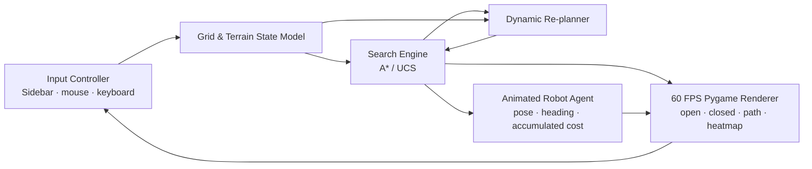

# Robot Path Planning Simulator

## Project metadata

| Field | Details |
|---|---|
| Course | INT3120 - Artificial Intelligence |
| Allotment | Project #14 — Robot Path Planning Simulator |
| Section | IT V Semester - Section C (Jul-Nov 2026) |
| Submission date | 02 Nov 2026 |
| Maximum marks | 15 |
| Team | Group 7 — Mohammad Ayaan & Sarath Mohanraj |

## Executive summary

This project demonstrates autonomous mobile-robot navigation on a discrete 2D grid. Cells represent free space, impassable obstacles, or weighted terrain. A* and Uniform Cost Search (UCS) plan minimum-cost routes using four- or eight-directional movement. A Pygame interface visualizes the search, compares both algorithms, allows dynamic obstacle injection, and animates the robot as it follows the route while reporting its accumulated cost.

## Problem statement

Given a start cell, goal cell, movement model, and grid containing walls and terrain costs, find a collision-free path with minimum total travel cost. The simulator also demonstrates how a planner responds when a new obstacle invalidates the route while the robot is moving.

## Technology stack

| Component | Implementation |
|---|---|
| Language | Python 3.10+ (benchmarked here with Python 3.13.7) |
| Graphics and interaction | Pygame 2.x; 800×800 grid, 350-pixel sidebar, 60 FPS event loop |
| Search frontier | `heapq` min-heap with a monotonic tie-break counter; push/pop O(log V) |
| State lookup | Dictionaries for best-known path costs and parent pointers, plus sets for open/closed membership; average O(1) membership/lookups |
| Standard-library utilities | `math` for movement/heuristics, `random` for seeded map generation, `time` for profiling, `tracemalloc` for allocation peaks |
| Runtime profiling | `time.perf_counter()`; search compute time excludes animated frame waits |
| Frontier memory | Maximum unique open-set size recorded per run |
| Python allocation profiling | `tracemalloc` in `benchmark_runner.py`, collected separately from timed runs |
| Automated verification | Python standard library `unittest`; tests do not open a display window |
| External packages | `pygame` only, listed in `requirements.txt` |

## System architecture



The controller edits the grid and selects an algorithm. Search yields progress states for rendering. A dynamic obstacle on the robot's remaining route starts a new search from the robot's nearest grid cell. When search completes, the agent animates the reconstructed route. Benchmark mode runs A* and UCS in sequence against the same cloned grid state.

## Mathematical model

### Terrain and movement costs

The start cell has no entry charge. Moving to a neighboring destination cell costs:

| Destination cell | Entry cost |
|---|---:|
| Normal | 1.0 |
| Sand | 3.0 |
| Water | 5.0 |
| Wall | Impassable |

In four-directional mode, an edge cost equals the destination terrain cost. In eight-directional mode, a diagonal edge costs `√2 × destination terrain cost`. Corner cutting is disallowed. The path cost `g(goal)` is the sum of edge costs from start to goal.

### Uniform Cost Search

UCS orders the frontier using accumulated cost only:

$$
f(n) = g(n)
$$

All edge costs satisfy `c(n,n′) ≥ ε > 0` (`ε = 1` in this model), and the grid has finite branching. Therefore only finitely many nodes can have path cost below any fixed bound, so UCS is complete. When a goal is removed from the minimum-priority frontier, no cheaper frontier route can remain; consequently the returned route is optimal.

### A* Search

A* uses:

$$
f(n) = g(n) + h(n)
$$

The heuristic is selected to match the movement model:

$$
h_M(n) = |x_n-x_g| + |y_n-y_g| \qquad \text{(4-directional)}
$$

$$
h_O(n) = \max(\Delta x,\Delta y) + (\sqrt{2}-1)\min(\Delta x,\Delta y)
\qquad \text{(8-directional)}
$$

Both estimates are multiplied by the minimum terrain entry cost, `min(c) = 1.0`. Sand and water can only increase edge costs. Thus, even if the cheapest remaining route uses only normal cells, these scaled distances do not overestimate its cost:

$$
h(n) \leq h^*(n)
$$

Manhattan distance is consistent for orthogonal steps. Octile distance is consistent for orthogonal and √2 diagonal steps; multiplying by the minimum cost preserves consistency. A* therefore remains optimal for the weighted grid.

### Complexity

Let `b` be the branching factor, `C*` the optimal path cost, `ε` the minimum positive edge cost, `V` the number of cells, and `E` the neighbor edges.

| Algorithm / view | Time | Space | Notes |
|---|---|---|---|
| UCS tree-search bound | `O(b^(1 + floor(C*/ε)))` | Same order | Positive minimum edge cost bounds nodes expanded below the optimal goal cost |
| A* tree-search bound | Exponential in solution depth in the worst case | Exponential in depth | An admissible heuristic reduces the effective branching factor when it provides useful goal direction |
| This finite-grid heap implementation | `O((V+E) log V)` worst case | `O(V+E)` | Consistent A* heuristics allow a cell to be closed once; UCS is Dijkstra's algorithm on this graph |

## Empirical benchmark results

Generated by `python benchmark_runner.py` on Python 3.13.7 / Pygame 2.6.1. Runtime is the mean of three `time.perf_counter()` runs. `tracemalloc` peak memory is measured in a separate pass to avoid slowing the timed run. Node savings are `(UCS nodes − A* nodes) / UCS nodes × 100`.

| Scenario | Algorithm | Nodes Explored | Execution (ms, mean of 3) | Peak Frontier | Path Cost | Nodes Saved by A* | Peak Python Memory (KiB) |
|---|---:|---:|---:|---:|---:|---:|---:|
| Open unobstructed grid · diagonal corner-to-corner | A* | 40 | 2.4238 | 155 | 55.154329 | 97.50% | 223.77 |
| Open unobstructed grid · diagonal corner-to-corner | UCS | 1,600 | 18.3790 | 79 | 55.154329 | — | 526.65 |
| Procedural DFS maze · seed 1402 | A* | 355 | 3.4205 | 6 | 248.000000 | 4.57% | 260.12 |
| Procedural DFS maze · seed 1402 | UCS | 372 | 3.4700 | 5 | 248.000000 | — | 259.70 |
| Weighted swamp and sand · seed 4205 | A* | 788 | 8.0762 | 147 | 90.000000 | 49.10% | 330.77 |
| Weighted swamp and sand · seed 4205 | UCS | 1,548 | 11.9445 | 69 | 90.000000 | — | 525.16 |
| U-shaped concave trap | A* | 290 | 2.5899 | 41 | 38.000000 | 67.88% | 214.61 |
| U-shaped concave trap | UCS | 903 | 6.4993 | 42 | 38.000000 | — | 318.96 |

The open grid highlights the benefit of an accurate diagonal heuristic. The DFS maze has a narrow corridor and a smaller node-count gap. The weighted map and U-trap show cases where goal-directed search avoids exploring much of the remaining map. Rerun the benchmark runner to regenerate the table for the current machine; runtimes and memory values will vary by environment.

## User guide

### Sidebar and keyboard controls

| Control | Action |
|---|---|
| **A* Search** / **Uniform Cost (UCS)** · `A` / `U` | Select planner |
| **Start / Goal** brush | Click to place start then goal; subsequent clicks move them in turn |
| **Wall** / **Sand (3×)** / **Water (5×)** · `W` / `S` / `E` | Select painting brush |
| **Eraser** or right-click | Remove terrain/walls; right-click a marker to remove it |
| **DFS Maze (M)** · `M` | Generate a reproducible-per-seed randomized DFS perfect maze |
| **Terrain Map (T)** · `T` | Scatter weighted sand and water patches |
| **Run Search (SPACE)** · `Space` | Animate the selected algorithm |
| **Benchmark Both (X)** · `X` | Run A*, then UCS, on the same captured grid |
| **Reset Path (R)** · `R` | Clear path, robot, and search state while preserving the map |
| **Clear All (C)** · `C` | Clear the map and endpoints |
| **Movement** · `D` | Toggle 4- and 8-directional movement |
| **1 Slow / 2 Normal / 3 Fast / 4 Instant** | Set search expansion speed |
| **Toggle Values** · `V` | Show the explored-cell `g(n)` heatmap and hover inspector |
| **Help** · `H` or `?` | Open the controls and formula modal; `Esc` closes it |

### Dynamic obstacle demonstration

Place endpoints, run a search, and let the robot begin traversing. Left-click a cell on the untraversed portion of the displayed route. The simulator inserts a wall, snaps the robot to its nearest grid cell, invalidates the old route, and starts a new search with the selected algorithm. The robot then animates the detour and continues accumulating destination terrain cost. Clicking the route after traversal has finished replays from the route's start for demonstration.

### Heatmap and hover inspector

Toggle **Values** or press `V`. Explored cells are colored by accumulated `g(n)` and show a compact numeric value. Hover over any grid cell to inspect its exact stored `g(n)`, heuristic `h(n)`, and priority `f(n)` in the sidebar. For UCS, `h(n)=0` and `f(n)=g(n)`.

## Automated tests and benchmark runner

```bash
python -m unittest test_algorithms.py
python benchmark_runner.py
python main.py
```

`test_algorithms.py` runs headlessly and verifies unweighted and weighted optimality, node efficiency, unreachable goals, and diagonal movement costs. `benchmark_runner.py` evaluates four fixed 40×40 scenarios and writes its Markdown table to `benchmark_results.md`.

## Viva-voce quick defense

1. **When does A* behave like UCS?** When its heuristic is zero for every node, so the priority becomes `f(n)=g(n)`.
2. **Why does UCS expand in circular waves on an open grid?** With uniform step costs, all cells at the same distance have equal accumulated cost; the frontier expands equal-cost contours outward. In 8-dir mode the contours follow the diagonal-aware movement metric.
3. **What if a heuristic overestimates the remaining cost?** A* can pop a goal before a cheaper route is considered, so optimality is no longer guaranteed.
4. **Why is the weighted-grid heuristic still admissible?** The distance estimate is multiplied by the minimum terrain cost, 1.0. Entering sand or water never costs less, so the estimate remains a lower bound.
5. **What happens when a new wall blocks the robot's route?** The route is invalidated and the active planner recomputes a least-cost route from the robot's current grid cell to the goal; the agent then follows the new path.
